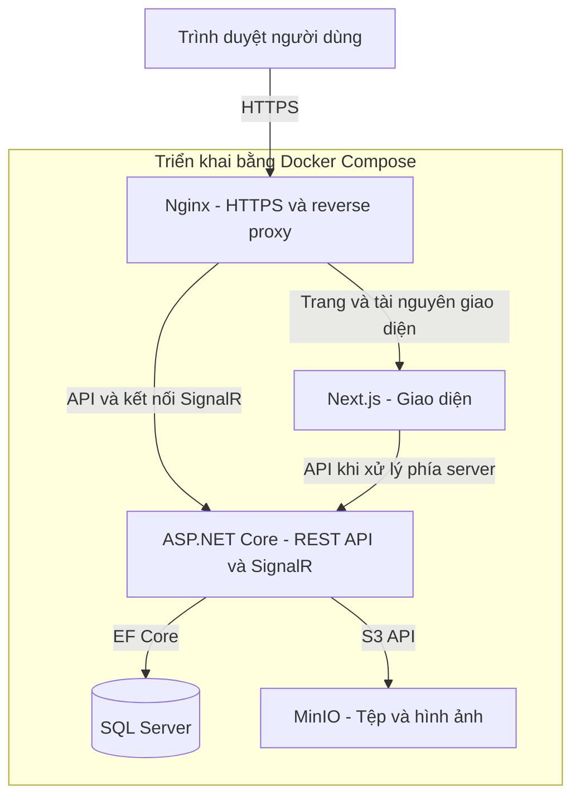

# Hệ thống quản lý nhà hàng

Ứng dụng quản lý một nhà hàng quy mô vừa, hỗ trợ **ăn tại bàn và mua mang về**. Hệ thống kết nối khách hàng, nhân viên phục vụ, bếp, bar và quản lý trong luồng đặt món, chế biến, phục vụ, thanh toán và kiểm soát nguyên liệu.

> **Trạng thái dự án:** Đang khởi tạo repository dựa trên tài liệu phân tích và thiết kế. Repository hiện chưa có mã nguồn ứng dụng, migration hoặc cấu hình triển khai. Các nội dung dưới đây mô tả phạm vi và định hướng xây dựng, không phải tính năng đã triển khai.

## Mục tiêu

- Theo dõi từng phần món qua các bước xác nhận, chế biến và giao khách.
- Hỗ trợ gọi thêm nhiều đợt trong một order và xử lý đồng thời tại bếp/bar.
- Quản lý thu tiền, hoàn tiền, tiêu hao nguyên liệu và đối soát ca.
- Phân quyền rõ ràng, lưu lịch sử thao tác và bảo vệ tính nhất quán dữ liệu.
- Tổ chức backend theo **Clean Architecture kết hợp Modular Monolith**.

## Đối tượng sử dụng

| Vai trò | Trách nhiệm chính |
| --- | --- |
| Khách hàng | Xem thực đơn, giá; gửi yêu cầu đặt món qua QR; theo dõi order của mình |
| Nhân viên | Tạo và xác nhận order, giao món, thu tiền, ghi nhận sự cố, chấm công |
| Bếp | Xem order, cập nhật chế biến món thuộc bếp, báo lỗi và làm lại theo phê duyệt |
| Bar | Xem order, cập nhật chế biến món thuộc bar, báo lỗi và làm lại theo phê duyệt |
| Quản lý | Điều hành, quản lý thực đơn/kho, phê duyệt nghiệp vụ, ca và báo cáo |
| Admin | Quản trị tài khoản, vai trò, quyền và cấu hình hệ thống |

Nhân viên có thể kiêm thu ngân; một tài khoản có thể có nhiều vai trò. Admin không mặc nhiên có toàn bộ quyền vận hành. Backend kiểm tra quyền cho từng hành động và phạm vi dữ liệu.

## Phạm vi chức năng

| Nhóm | Chức năng chính |
| --- | --- |
| 1. Quản trị hệ thống | Đăng nhập, tài khoản, vai trò, phân quyền, cấu hình và nhật ký thao tác |
| 2. Khu vực và bàn | Quản lý khu vực, bàn, phiên sử dụng; trạng thái trống/đang sử dụng |
| 3. Thực đơn và công thức | Nhóm món, giá, size, topping, tùy chọn, nơi chế biến và định lượng |
| 4. Order | Ăn tại bàn/mang về, khách tự gửi yêu cầu hoặc nhân viên đặt, xác nhận, gọi thêm, hủy hợp lệ |
| 5. Chế biến | Chuyển món đến bếp/bar, bắt đầu, hoàn thành từng phần, báo lỗi và làm lại |
| 6. Phục vụ | Theo dõi món sẵn sàng, xác nhận giao từng phần, tiếp nhận trả món/sự cố |
| 7. Thanh toán | Thu một phần/toàn bộ, kết hợp phương thức, tiền thừa, chứng từ bán hàng và hoàn tiền |
| 8. Kho và nhà cung cấp | Nhập nguyên liệu, giá nhập, quy đổi đơn vị, kiểm kê, điều chỉnh, cảnh báo và kiểm soát món |
| 9. Chấm công và ca | Check-in/check-out, quản lý phê duyệt, mở/chốt ca và đối soát |
| 10. Báo cáo | Doanh thu, món bán, tồn kho và thông tin vận hành theo quyền |

### Luồng vận hành chính

1. Khách gửi yêu cầu qua QR hoặc nhân viên tạo order tại bàn/mang về.
2. Nhân viên/quản lý xác nhận yêu cầu; hệ thống kiểm tra khả dụng và chuyển món đến bếp/bar phụ trách.
3. Bếp/bar cập nhật bắt đầu và hoàn thành theo từng phần món.
4. Nhân viên nhận món sẵn sàng và xác nhận đã giao cho khách.
5. Nhân viên thu tiền và xử lý nghĩa vụ còn lại; việc thu tiền có thể diễn ra trước khi phục vụ xong.
6. Order được đóng khi đã xử lý xong các phần món và nghĩa vụ thu/hoàn. Với ăn tại bàn, nhân viên kết thúc phiên khi khách rời.

### Quy tắc nghiệp vụ trọng tâm

- QR là kênh bổ sung, không bắt buộc; yêu cầu của khách cần được xác nhận trước khi chế biến.
- Một order có thể có nhiều đợt gọi món. Món hoàn thành và giao khách được theo dõi theo số lượng thực tế.
- Bếp/bar xem được toàn bộ order nhưng chỉ cập nhật món thuộc khu vực được giao.
- Nhân viên được hủy trước khi bắt đầu chế biến. Sự cố sau đó được xử lý theo quyền quản lý, có lý do và lịch sử.
- Làm lại liên kết với món gốc, có lần chế biến riêng và tiêu hao bổ sung; không tự phát sinh doanh thu mới.
- Nguyên liệu được trừ khi hoàn thành chế biến; ghi hao hụt phải tránh trừ lặp nguyên liệu đã tiêu hao.
- Định lượng hỗ trợ size/topping/tùy chọn. Hệ thống tự khóa món thiếu nguyên liệu; ngoại lệ của quản lý cần lưu lý do.
- Thanh toán hỗ trợ thu nhiều lần và kết hợp tiền mặt/chuyển khoản; thẻ theo cấu hình. Chuyển khoản được xác nhận thực tế bởi nhân viên, chưa tích hợp ngân hàng tự động.
- Hoàn tiền cần quản lý phê duyệt, giữ nguyên giao dịch gốc và kiểm soát hạn mức; có thể hoàn khác phương thức thu ban đầu.
- Thanh toán đủ không tự làm bàn trống. Bàn chỉ có hai trạng thái: trống và đang sử dụng.
- Chấm công bằng tài khoản đăng nhập và xác nhận check-in/check-out, cần quản lý phê duyệt.
- Chỉ quản lý xem báo cáo doanh thu và tồn kho; thao tác nhạy cảm phải được ghi audit.

### Ngoài phạm vi phiên bản đầu

Giao hàng, đa chi nhánh, đặt bàn trước, quản lý lô/hạn sử dụng, tính lương, lập lịch nhân sự, khuyến mãi/giảm giá, VAT/phí phục vụ, công nợ, tích hợp ngân hàng tự động và hóa đơn điện tử thuế. Chứng từ điện tử trong hệ thống là chứng từ bán hàng. Tách hóa đơn chưa thuộc baseline triển khai.

## Công nghệ dự kiến

Các phiên bản dưới đây là baseline từ tài liệu thiết kế. Phiên bản vá, tương thích dependency và giấy phép sẽ được rà soát khi khởi tạo ứng dụng; repository chưa có lockfile xác nhận cấu hình chạy.

| Thành phần | Lựa chọn |
| --- | --- |
| Backend | C#, ASP.NET Core .NET 10, Entity Framework Core 10 |
| Frontend | Next.js 16 App Router, React 19, TypeScript strict; baseline TypeScript 5.9, Node.js 24 |
| Giao diện | Tailwind CSS, shadcn/ui |
| Trạng thái và biểu mẫu | TanStack Query, Zustand, React Hook Form, Zod |
| Xác thực dữ liệu backend | FluentValidation |
| Cơ sở dữ liệu | SQL Server 2022 |
| Danh tính và phân quyền | ASP.NET Core Identity, JWT/refresh token, role/policy authorization |
| API | REST, OpenAPI, TypeScript client sinh từ hợp đồng API |
| Thời gian thực | ASP.NET Core SignalR |
| Tác vụ nền | Hangfire với SQL Server |
| Tệp và hình ảnh | MinIO qua API tương thích S3 |
| Mạng và triển khai | Nginx, HTTPS, Docker Compose trên VPS |
| Nhật ký và sức khỏe | Serilog, audit nghiệp vụ riêng, health checks |
| Kiểm thử và CI | xUnit, kiểm thử tích hợp, GitHub Actions |

Baseline sử dụng **MinIO**, không sử dụng Cloudflare R2. Phiên bản đầu chưa cần microservices, Kubernetes, Redis hoặc message broker.

## Kiến trúc hệ thống

Nginx tiếp nhận yêu cầu và định tuyến đến giao diện hoặc backend. Trình duyệt gọi API/SignalR qua Nginx; Next.js có thể gọi backend khi xử lý phía server. Backend kiểm tra quyền, thực thi nghiệp vụ và truy cập dữ liệu. Frontend không kết nối trực tiếp SQL Server.

Docker Compose đóng gói và vận hành các thành phần. Bảo mật, ghi log, audit, health checks và sao lưu là các mối quan tâm xuyên suốt, không phải một bước trung gian trong luồng request.

### Clean Architecture

| Lớp | Trách nhiệm và hướng phụ thuộc |
| --- | --- |
| Domain | Thực thể, quy tắc và bất biến nghiệp vụ; không phụ thuộc framework/hạ tầng |
| Application | Use case và hợp đồng truy cập hạ tầng; phụ thuộc Domain |
| Infrastructure | EF Core, lưu trữ tệp, danh tính và tích hợp; thực hiện hợp đồng Application |
| API/Host | Endpoint, xác thực request, cấu hình và lắp ghép module |

Backend là **một đơn vị triển khai** theo Modular Monolith. Quy tắc phụ thuộc hướng vào Domain/Application theo tư tưởng Clean Architecture của Robert C. Martin.

### Module và quyền sở hữu dữ liệu

| Module | Schema | Phạm vi sở hữu |
| --- | --- | --- |
| Identity | `identity` | Tài khoản, vai trò, quyền |
| Seating | `seating` | Khu vực, bàn, phiên bàn |
| Catalog | `catalog` | Thực đơn, biến thể, tùy chọn, giá |
| Sales | `sales` | Order, đợt gọi món, chi tiết và giá chốt |
| Fulfillment | `fulfillment` | Chế biến, phục vụ, sự cố, làm lại |
| Billing | `billing` | Hóa đơn, thu tiền, điều chỉnh, hoàn tiền |
| Inventory | `inventory` | Nguyên liệu, công thức, nhà cung cấp, biến động kho |
| Workforce | `workforce` | Chấm công, ca vận hành |
| Audit | `audit` | Lịch sử thao tác nhạy cảm |
| Reporting | `reporting` | Mô hình đọc và tổng hợp báo cáo |

Mười nhóm chức năng phục vụ mô tả nghiệp vụ; các module là ranh giới kỹ thuật nên không ánh xạ một-một. Ví dụ, Fulfillment gồm cả chế biến và phục vụ; Inventory sở hữu công thức, Catalog sở hữu thực đơn và giá.

- Mỗi module có **DbContext, schema và lịch sử migration độc lập** trong cùng một database SQL Server.
- Không chia sẻ EF entity/navigation giữa các module; giao tiếp qua ID, hợp đồng và sự kiện.
- Baseline không dùng khóa ngoại vật lý xuyên schema. Application phải kiểm tra các tham chiếu liên module và bảo vệ quy tắc nghiệp vụ.
- Thao tác cần nguyên tử như hoàn thành món và trừ kho phải được điều phối transaction; thiết kế dự kiến dùng chung `DbConnection`/`DbTransaction` giữa các DbContext liên quan.
- Thông báo được phát sau commit; dự kiến dùng Outbox cho sự kiện và cập nhật mô hình đọc để tránh mất thông báo khi tiến trình gặp lỗi.

## Yêu cầu chất lượng

- Kiểm tra quyền tại backend và giới hạn khách truy cập đúng phiên/order được cấp.
- Chống gửi lặp và xung đột cập nhật trong thu tiền, hoàn tiền, hoàn thành món và trừ kho.
- Chốt giá/công thức tại thời điểm nghiệp vụ phù hợp, bảo toàn dữ liệu lịch sử.
- Kiểm thử các trường hợp hoàn thành/giao một phần, làm lại, thiếu kho, thanh toán hỗn hợp và hoàn tiền.
- Cấu hình secret ngoài mã nguồn; không commit mật khẩu, token hoặc chuỗi kết nối thật.
- Có sao lưu/khôi phục dữ liệu và tệp, audit và quy trình đối soát giao dịch chưa xác định kết quả.

## Trạng thái triển khai và bước tiếp theo

Repository hiện có README này. Chưa có solution .NET, ứng dụng Next.js, Dockerfile, Compose hoặc bộ kiểm thử, nên chưa có lệnh chạy ứng dụng để cung cấp.

1. Khởi tạo backend/frontend và khóa phiên bản dependency.
2. Thiết lập module, DbContext/schema và migration độc lập.
3. Xây dựng luồng order → chế biến → phục vụ → thanh toán.
4. Bổ sung kho định lượng, sự cố/hoàn tiền, ca, chấm công và báo cáo.
5. Hoàn thiện kiểm thử, CI, triển khai và vận hành.

## Tài liệu

Tài liệu phân tích, đặc tả use case, sơ đồ, thiết kế dữ liệu và báo cáo đang nằm trong workspace tài liệu riêng, chưa được đưa vào repository này. Khi bổ sung, cần đồng bộ với thiết kế hiện hành và phân biệt script DB minh họa với migration triển khai ứng dụng.

## Giấy phép

Repository chưa có file `LICENSE`; giấy phép sử dụng mã nguồn chưa được công bố.
