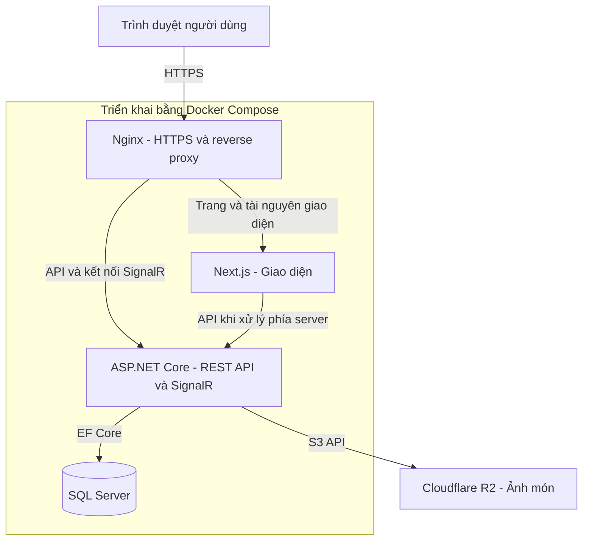

# Hệ thống quản lý nhà hàng

Ứng dụng quản lý một nhà hàng quy mô vừa, hỗ trợ **ăn tại bàn và mua mang về**. Hệ thống kết nối khách hàng, nhân viên phục vụ, bếp, bar và quản lý trong luồng đặt món, chế biến, phục vụ, thanh toán và kiểm soát nguyên liệu.

> **Trạng thái dự án:** Đã khởi tạo base backend .NET 10 theo Clean Architecture + Modular Monolith, gồm 10 module, DbContext/schema độc lập, API Host, JWT validation, health checks và kiểm thử. Các chức năng nhà hàng bên dưới là phạm vi sẽ triển khai; hiện chưa có luồng nghiệp vụ, migration hoặc frontend.

## Chạy base backend

Yêu cầu .NET SDK theo [global.json](global.json). Từ thư mục gốc repo:

```powershell
dotnet restore RestaurantManagement.slnx --locked-mode
dotnet build RestaurantManagement.slnx -c Release --no-restore
dotnet test RestaurantManagement.slnx -c Release --no-build --no-restore

# Key riêng cho phiên phát triển, không in hoặc commit.
$jwtBytes = New-Object byte[] 48
$rng = [System.Security.Cryptography.RandomNumberGenerator]::Create()
$rng.GetBytes($jwtBytes)
$rng.Dispose()
$env:Jwt__SigningKey = [Convert]::ToBase64String($jwtBytes)

dotnet run --project src/Host/Restaurant.Api --launch-profile http --no-restore
```

API local: `http://localhost:5080`. Liveness: `/health/live`; OpenAPI JSON trong
Development: `/openapi/v1.json`. Chưa có Swagger UI. `/health/ready` cần SQL Server;
host không tự tạo database hoặc chạy migration. Endpoint `/api/system/modules`
cần JWT có role `Admin`; base chưa có endpoint phát hành token.

Xem [cấu trúc và cấu hình backend](docs/backend-foundation.md),
[Git workflow](CONTRIBUTING.md) và [GitHub Actions](.github/workflows/backend-ci.yml).

## Mục tiêu

- Theo dõi từng phần món qua các bước xác nhận, chế biến và giao khách.
- Hỗ trợ gọi thêm nhiều đợt trong một order và xử lý đồng thời tại bếp/bar.
- Quản lý thu tiền, hoàn tiền, lượng dùng nguyên liệu, giá vốn, lợi nhuận gộp theo ngày và đối soát tiền mặt theo ngày bán.
- Phân quyền rõ ràng, lưu lịch sử thao tác và bảo vệ tính nhất quán dữ liệu.
- Tổ chức backend theo **Clean Architecture kết hợp Modular Monolith**.

## Đối tượng sử dụng

| Vai trò | Trách nhiệm chính |
| --- | --- |
| Khách hàng | Xem thực đơn, giá; gửi yêu cầu đặt món qua QR; theo dõi order của mình |
| Nhân viên | Tạo và xác nhận order, giao món, thu tiền, ghi nhận sự cố |
| Bếp | Xem order, cập nhật chế biến món thuộc bếp, báo lỗi và làm lại theo phê duyệt |
| Bar | Xem order, cập nhật chế biến món thuộc bar, báo lỗi và làm lại theo phê duyệt |
| Quản lý | Điều hành, quản lý thực đơn/kho, phê duyệt nghiệp vụ, ca và báo cáo |
| Admin | Quản trị tài khoản, vai trò, quyền và cấu hình hệ thống |

Nhân viên có thể kiêm thu ngân; một tài khoản có thể có nhiều vai trò. Admin không mặc nhiên có toàn bộ quyền vận hành. Backend kiểm tra quyền cho từng hành động và phạm vi dữ liệu.

## Phạm vi chức năng

| Nhóm | Chức năng chính |
| --- | --- |
| 1. Quản trị hệ thống | Đăng nhập, tài khoản, vai trò, phân quyền, cấu hình và nhật ký thao tác |
| 2. Khu vực và bàn | Quản lý khu vực, bàn, phiên sử dụng, chuyển bàn; trạng thái trống/đang sử dụng |
| 3. Thực đơn | Nhóm món, giá, size, topping, tùy chọn, nơi chế biến; đánh dấu hết món ở cấp món/biến thể/topping |
| 4. Order | Ăn tại bàn/mang về, khách tự gửi yêu cầu hoặc nhân viên đặt, xác nhận, gọi thêm, hủy hợp lệ |
| 5. Chế biến | Chuyển món đến bếp/bar, bắt đầu, hoàn thành từng phần, báo lỗi và làm lại |
| 6. Phục vụ | Theo dõi món sẵn sàng, xác nhận giao từng phần, tiếp nhận trả món/sự cố |
| 7. Thanh toán | Thu một phần/toàn bộ, kết hợp phương thức, tiền thừa, chứng từ bán hàng, miễn thu và hoàn tiền |
| 8. Kho và nhà cung cấp | Phiếu nhập và giá nhập trong ngày, đếm tồn cuối khi chốt, tính lượng dùng, giá vốn và lợi nhuận gộp theo ngày |
| 9. Ngày bán | Mở/chốt ngày bán và đối soát tiền mặt |
| 10. Báo cáo | Doanh thu, thất thu, giá vốn, lợi nhuận gộp theo ngày/tuần/tháng, món bán, tồn kho và thông tin vận hành theo quyền |

### Luồng vận hành chính

1. Quản lý mở ngày bán. Khách gửi yêu cầu qua QR (khi nhân viên đã mở phiên bàn) hoặc nhân viên tạo order tại bàn/mang về.
2. Nhân viên/quản lý xác nhận yêu cầu và chuyển món đến bếp/bar phụ trách.
3. Bếp/bar cập nhật bắt đầu và hoàn thành theo từng phần món.
4. Nhân viên nhận món sẵn sàng và xác nhận đã giao cho khách.
5. Nhân viên thu tiền và xử lý nghĩa vụ còn lại; việc thu tiền có thể diễn ra trước khi phục vụ xong.
6. Order được đóng khi đã xử lý xong các phần món và nghĩa vụ thu/hoàn (thu đủ hoặc quản lý miễn thu). Với ăn tại bàn, nhân viên kết thúc phiên khi khách rời.
7. Trong ngày nhân viên/quản lý nhập phiếu nhập nguyên liệu kèm giá nhập; cuối ngày nhân viên đếm tồn, quản lý duyệt và chốt ngày bán (chỉ khi không còn order mở). Hệ thống tính lượng dùng, giá vốn và lợi nhuận gộp của ngày.

### Quy tắc nghiệp vụ trọng tâm

- QR là kênh bổ sung, không bắt buộc; yêu cầu của khách cần được xác nhận trước khi chế biến.
- Một order có thể có nhiều đợt gọi món. Món hoàn thành và giao khách được theo dõi theo số lượng thực tế.
- Bếp/bar xem được toàn bộ order nhưng chỉ cập nhật món thuộc khu vực được giao.
- Nhân viên được hủy trước khi bắt đầu chế biến. Sự cố sau đó được xử lý theo quyền quản lý, có lý do và lịch sử.
- Làm lại liên kết với món gốc, có lần chế biến riêng; không tự phát sinh doanh thu mới.
- Không trừ kho theo món. Lượng dùng = tồn đầu + nhập − tồn cuối, tính khi chốt ngày bán.
- Hệ thống không tự khóa món theo tồn; bếp, bar, nhân viên hoặc quản lý đánh dấu hết món (cấp món/biến thể/topping) và mở bán lại; cờ đặt lại khi mở ngày mới. Giá vốn tính bình quân gia quyền theo kỳ, có tính tồn đầu.
- Thanh toán hỗ trợ thu nhiều lần và kết hợp tiền mặt/chuyển khoản; thẻ theo cấu hình. Chuyển khoản được xác nhận thực tế bởi nhân viên, chưa tích hợp ngân hàng tự động.
- Quản lý có thể miễn thu phần không thu được (có lý do, tách khỏi doanh thu). Ngày bán chỉ chốt khi không còn order mở và đã đủ số đếm tồn.
- Hoàn tiền cần quản lý phê duyệt, giữ nguyên giao dịch gốc và kiểm soát hạn mức; có thể hoàn khác phương thức thu ban đầu.
- Thanh toán đủ không tự làm bàn trống. Bàn chỉ có hai trạng thái: trống và đang sử dụng; có thể chuyển bàn khi phiên đang mở.
- Chỉ quản lý xem báo cáo doanh thu, giá vốn, lợi nhuận và tồn kho; thao tác nhạy cảm phải được ghi audit.

### Ngoài phạm vi phiên bản đầu

Giao hàng, đa chi nhánh, đặt bàn trước, quản lý lô/hạn sử dụng, công thức/định lượng và trừ kho theo món, lợi nhuận theo món/order, chi phí vận hành khác, gộp bàn, chế độ offline, tính lương, lập lịch nhân sự, khuyến mãi/giảm giá, VAT/phí phục vụ, công nợ, tích hợp ngân hàng tự động và hóa đơn điện tử thuế. Chứng từ điện tử trong hệ thống là chứng từ bán hàng. Tách hóa đơn chưa thuộc baseline triển khai.

## Công nghệ dự kiến

Các phiên bản dưới đây là baseline sản phẩm từ tài liệu thiết kế. Dependency backend
đã triển khai được quản lý tại `Directory.Packages.props` và các `packages.lock.json`;
những thành phần còn lại được bổ sung khi triển khai chức năng tương ứng.

| Thành phần | Lựa chọn |
| --- | --- |
| Backend | C#, ASP.NET Core .NET 10, Entity Framework Core 10 |
| Frontend | Next.js 16 App Router, React 19, TypeScript strict; baseline TypeScript 5.9, Node.js 24 |
| Giao diện | Tailwind CSS, shadcn/ui |
| Trạng thái và biểu mẫu | TanStack Query, Zustand, React Hook Form, Zod |
| Xác thực dữ liệu backend | FluentValidation |
| Cơ sở dữ liệu | SQL Server 2022 |
| Danh tính và phân quyền | ASP.NET Core Identity, JWT/refresh token, role/policy authorization |
| API | REST, OpenAPI, TypeScript client sinh từ hợp đồng API |
| Thời gian thực | ASP.NET Core SignalR |
| Tác vụ nền | Hangfire với SQL Server |
| Tệp và hình ảnh | Cloudflare R2 qua API tương thích S3 |
| Mạng và triển khai | Nginx, HTTPS, Docker Compose trên VPS |
| Nhật ký và sức khỏe | Serilog, audit nghiệp vụ riêng, health checks |
| Kiểm thử và CI | xUnit, kiểm thử tích hợp, GitHub Actions |

Baseline sử dụng **Cloudflare R2** (thay MinIO từ 2026-11-01): ảnh món ở bucket công khai, bản sao lưu SQL ở bucket thứ hai private. Phiên bản đầu chưa cần microservices, Kubernetes, Redis hoặc message broker.

## Kiến trúc hệ thống



Nginx tiếp nhận yêu cầu và định tuyến đến giao diện hoặc backend. Trình duyệt gọi API/SignalR qua Nginx; Next.js có thể gọi backend khi xử lý phía server. Backend kiểm tra quyền, thực thi nghiệp vụ và truy cập dữ liệu. Frontend không kết nối trực tiếp SQL Server.

Docker Compose đóng gói và vận hành các thành phần. Bảo mật, ghi log, audit, health checks và sao lưu là các mối quan tâm xuyên suốt, không phải một bước trung gian trong luồng request.

### Clean Architecture

| Lớp | Trách nhiệm và hướng phụ thuộc |
| --- | --- |
| Domain | Thực thể, quy tắc và bất biến nghiệp vụ; không phụ thuộc framework/hạ tầng |
| Application | Use case và hợp đồng truy cập hạ tầng; phụ thuộc Domain |
| Infrastructure | EF Core, lưu trữ tệp, danh tính và tích hợp; thực hiện hợp đồng Application |
| API/Host | Endpoint, xác thực request, cấu hình và lắp ghép module |

Backend là **một đơn vị triển khai** theo Modular Monolith. Quy tắc phụ thuộc hướng vào Domain/Application theo tư tưởng Clean Architecture của Robert C. Martin.

### Module và quyền sở hữu dữ liệu

| Module | Schema | Phạm vi sở hữu |
| --- | --- | --- |
| Identity | `identity` | Tài khoản, vai trò, quyền |
| Seating | `seating` | Khu vực, bàn, phiên bàn, chuyển bàn |
| Catalog | `catalog` | Thực đơn, biến thể, tùy chọn, giá |
| Sales | `sales` | Order, đợt gọi món, chi tiết và giá chốt |
| Fulfillment | `fulfillment` | Chế biến, phục vụ, sự cố, làm lại |
| Billing | `billing` | Chứng từ, thu tiền, miễn thu, điều chỉnh, hoàn tiền |
| Inventory | `inventory` | Nguyên liệu, nhà cung cấp, phiếu nhập, tồn đầu/cuối theo ngày bán, lượng dùng và giá vốn |
| SalesDay | `salesday` | Ngày bán (mở/chốt), đối soát tiền mặt |
| Audit | `audit` | Lịch sử thao tác nhạy cảm |
| Reporting | `reporting` | Mô hình đọc và tổng hợp báo cáo |

Mười nhóm chức năng phục vụ mô tả nghiệp vụ; các module là ranh giới kỹ thuật nên không ánh xạ một-một. Ví dụ, Fulfillment gồm cả chế biến và phục vụ; Inventory sở hữu nguyên liệu và tồn theo ngày, Catalog sở hữu thực đơn và giá.

- Mỗi module có **DbContext, schema và lịch sử migration độc lập** trong cùng một database SQL Server.
- Không chia sẻ EF entity/navigation giữa các module; giao tiếp qua ID, hợp đồng và sự kiện.
- Baseline không dùng khóa ngoại vật lý xuyên schema. Application phải kiểm tra các tham chiếu liên module và bảo vệ quy tắc nghiệp vụ.
- Thao tác cần nguyên tử như chốt ngày bán (đếm tồn cuối, tổng hợp doanh thu và giá vốn) phải được điều phối transaction; nếu ghi nhiều DbContext thì dùng chung `DbConnection`/`DbTransaction`. Hoàn thành món không còn trừ kho nên không cần transaction liên module.
- Thông báo được phát sau commit; dự kiến dùng Outbox cho sự kiện và cập nhật mô hình đọc để tránh mất thông báo khi tiến trình gặp lỗi.

## Yêu cầu chất lượng

- Kiểm tra quyền tại backend và giới hạn khách truy cập đúng phiên/order được cấp.
- Chống gửi lặp và xung đột cập nhật trong thu tiền, hoàn tiền, hoàn thành món, miễn thu và chốt ngày bán.
- Chốt giá bán và giá nhập tại thời điểm nghiệp vụ phù hợp, bảo toàn dữ liệu lịch sử.
- Kiểm thử các trường hợp hoàn thành/giao một phần, làm lại, tồn cuối bất thường, thanh toán hỗn hợp và hoàn tiền.
- Cấu hình secret ngoài mã nguồn; không commit mật khẩu, token hoặc chuỗi kết nối thật.
- Có sao lưu/khôi phục dữ liệu và tệp (bản sao SQL lưu ngoài VPS), audit và quy trình đối soát giao dịch chưa xác định kết quả.

## Trạng thái triển khai và bước tiếp theo

Đã có solution `RestaurantManagement.slnx`: một API Host, 40 project thuộc 10 module,
hai project kiểm thử và CI restore/build/test/publish. Domain/Application là khung
để phát triển; Identity có EF model chuẩn, các module khác chưa có entity nghiệp vụ.

1. Da co login/me/logout/change-password voi phien SQL va JWT ngan han; tiep theo la refresh token, quyen nghiep vu va frontend Next.js.
2. Thêm entity, EF configuration và migration riêng cho từng module.
3. Xây dựng luồng order → chế biến → phục vụ → thanh toán, kèm transaction và Outbox.
4. Bổ sung nhập nguyên liệu/tồn cuối theo ngày, sự cố/hoàn tiền, chốt ngày bán và báo cáo lợi nhuận.
5. Tích hợp Cloudflare R2, SignalR, Hangfire, Serilog và cấu hình Docker/Nginx để triển khai.

## Tài liệu

Identity migration and explicit admin bootstrap are documented in
[docs/identity-initialization.md](docs/identity-initialization.md).
Login/current account/logout/password change are documented in
[docs/identity-authentication.md](docs/identity-authentication.md). Refresh tokens
and operational permission handlers remain future work.

Current imported scope, proposed data design and report limitations are indexed
in [docs/SYNC_STATUS.md](docs/SYNC_STATUS.md). This index supersedes older notes
below claiming all analysis documents remain outside this repository.

Hướng dẫn base code nằm tại [docs/backend-foundation.md](docs/backend-foundation.md).
Thiết kế nền tảng được ghi tại [backend foundation design](docs/superpowers/specs/2026-10-29-backend-foundation-design.md).
Tài liệu phân tích chi tiết, use case, sơ đồ và báo cáo vẫn ở workspace tài liệu riêng;
chưa được chép vào repo. Script DB minh họa không thay thế migration sản phẩm. Các tài liệu đó chưa được cập nhật theo thay đổi kho và Cloudflare R2 (2026-11-01).

## Giấy phép

Repository chưa có file `LICENSE`; giấy phép sử dụng mã nguồn chưa được công bố.
> MVP OVERRIDE 2026-11-05: The imported scope in docs/superpowers/specs/2026-11-05-restaurant-mvp-scope.md overrides older scope notes. QR and sound remain required. Data design proposals are not approved migrations; see docs/SYNC_STATUS.md.
