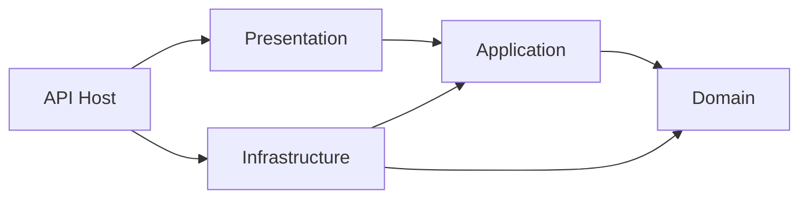

# Hướng dẫn base backend

## Cấu trúc
```text
restaurant-management-system/
|-- RestaurantManagement.slnx
|-- global.json
|-- Directory.Build.props
|-- Directory.Packages.props
|-- .config/dotnet-tools.json
|-- .github/workflows/backend-ci.yml
|-- src/
|   |-- Host/Restaurant.Api/
|   |   |-- Configuration/
|   |   |-- Modules/ModuleRegistration.cs
|   |   |-- Properties/launchSettings.json
|   |   |-- Program.cs
|   |   |-- appsettings.json
|   |   `-- appsettings.Development.json
|   `-- Modules/
|       |-- Identity/
|       |-- Seating/
|       |-- Catalog/
|       |-- Sales/
|       |-- Fulfillment/
|       |-- Billing/
|       |-- Inventory/
|       |-- Workforce/
|       |-- Audit/
|       `-- Reporting/
|-- tests/
|   |-- Restaurant.ArchitectureTests/
|   `-- Restaurant.IntegrationTests/
`-- docs/
```

Mỗi module có cấu trúc như Catalog:

```text
Catalog/
|-- Restaurant.Modules.Catalog.Domain/
|-- Restaurant.Modules.Catalog.Application/
|-- Restaurant.Modules.Catalog.Infrastructure/
|   |-- Persistence/
|   |   |-- CatalogDbContext.cs
|   |   |-- CatalogDbContextFactory.cs
|   |   `-- CatalogPersistence.cs
|   `-- CatalogModule.cs
`-- Restaurant.Modules.Catalog.Presentation/
    `-- CatalogEndpoints.cs
```

Domain/Application hiện chỉ có assembly marker. Khi triển khai use case, thêm entity
vào Domain, interface và use case vào Application, repository/EF configuration vào
Infrastructure và HTTP endpoint vào Presentation. Không cần tạo trước các thư mục
rỗng hoặc generic repository.

## Hướng phụ thuộc


Mũi tên là project reference, không phải luồng request. Host lắp ghép module.
Presentation không gọi DbContext trực tiếp. Infrastructure thực hiện hợp đồng
Application. Domain không dùng EF/ASP.NET Core. DependencyTests kiểm tra các project
reference khai báo. CI build kiểm tra code biên dịch được.

Hiện chưa có giao tiếp liên module; khi cần, tạo project Contracts nhỏ do module
cung cấp sở hữu, chứa DTO/interface/sự kiện thuần và cập nhật architecture tests.
Không tham chiếu Infrastructure/Domain của module khác và không chia sẻ EF entity.
Shared Kernel chỉ bổ sung khi có khái niệm thật sự chung; không tạo Common chứa mọi thứ.

## Tham khảo từ bài mẫu
Đã đọc trực tiếp các project, AppDbContext, ProductService, repository interface và
Program.cs trong `CleanArchitectureDemo-Buoi4.rar`. Giữ dependency inversion và
composition root, chuyển mô hình bốn lớp toàn cục sang bốn lớp trong từng module.
Đổi SQLite thành SQL Server, không tự tạo/seed database lúc chạy ứng dụng.
Discount demo không thuộc nghiệp vụ đã chốt nên không được đưa vào.

## Công cụ và phiên bản
- .NET SDK 10.0.300 hoặc bản vá cùng feature band, theo `global.json`.
- ASP.NET Core/EF Core package 10.0.8, quản lý tập trung và khóa dependency.
- SQL Server 2022 cho môi trường dữ liệu.
- EF CLI cục bộ 10.0.8: `dotnet tool restore`.
- Khi nâng .NET, cập nhật SDK/runtime, package và tool cùng nhánh 10.0 phù hợp,
  rồi chạy toàn bộ kiểm thử; không coi bản SDK cài sẵn là bản mới nhất.

NuGet đã phát hiện dependency gián tiếp cần vá nên base pin
`Microsoft.OpenApi 2.7.5` và `System.Security.Cryptography.Pkcs 10.0.13`.
Các phiên bản này chỉ nâng những dependency xuất hiện thực tế, không kéo package vào
Domain/Application. Không tắt NuGet audit hoặc bỏ qua cảnh báo.

Nguồn đối chiếu:
- [EF Core migration history](https://learn.microsoft.com/en-us/ef/core/managing-schemas/migrations/history-table)
- [OpenAPI advisory](https://github.com/advisories/GHSA-v5pm-xwqc-g5wc)
- [Pkcs advisory](https://github.com/advisories/GHSA-846f-f764-76mx)
- [GitHub Actions cho .NET](https://docs.github.com/en/actions/tutorials/build-and-test-code/net)

## Chạy local
Từ thư mục gốc repo, dùng PowerShell:

```powershell
dotnet restore RestaurantManagement.slnx --locked-mode
dotnet build RestaurantManagement.slnx -c Release --no-restore

# Sinh key riêng cho phiên local; không in hoặc commit key.
$jwtBytes = New-Object byte[] 48
$rng = [System.Security.Cryptography.RandomNumberGenerator]::Create()
$rng.GetBytes($jwtBytes)
$rng.Dispose()
$env:Jwt__SigningKey = [Convert]::ToBase64String($jwtBytes)

dotnet run --project src/Host/Restaurant.Api --launch-profile http --no-restore
```

API: `http://localhost:5080`.
Nếu cổng đã được sử dụng, truyền `--urls http://localhost:5081` khi chạy.
OpenAPI JSON trong Development: `/openapi/v1.json`. Chưa có Swagger UI.
`/health/live` trả 200 khi host hoạt động, kể cả khi chưa có database.
`/health/ready` trả 503 khi không kết nối được SQL Server; 200 chỉ xác nhận
kết nối/truy vấn SQL, chưa kiểm tra phiên bản migration hay MinIO.

Chuỗi kết nối Development mặc định dùng Windows Authentication với
`localhost/RestaurantManagement`. Đổi theo SQL Server của bạn:

```powershell
$env:ConnectionStrings__Restaurant = 'Server=localhost;Database=RestaurantManagement;Trusted_Connection=True;Encrypt=True;TrustServerCertificate=True'
```

Trên Linux/container dùng tài khoản SQL riêng và secret của môi trường.
Không commit mật khẩu. Production phải cấu hình chuỗi kết nối, JWT key, issuer,
audience, AllowedHosts, origin CORS và HTTPS. TrustServerCertificate trong cấu hình
Development không phải khuyến nghị cho Production.

## Xác thực và endpoint
- JWT được kiểm tra chữ ký HS256, issuer, audience và hạn dùng.
- Key tối thiểu 32 byte UTF-8; nên sinh ngẫu nhiên ít nhất 32 byte.
- Fallback policy yêu cầu đăng nhập; từng nhóm endpoint module cũng yêu cầu xác thực.
- `GET /api/system/modules` cần role claim `role=Admin`; chưa đăng nhập trả 401,
  đăng nhập sai role trả 403.
- Đây là quyền quản trị kỹ thuật, không cấp Admin quyền báo cáo doanh thu/tồn kho.
- Health endpoints và OpenAPI trong Development được mở rõ ràng bằng AllowAnonymous.
- Chưa có endpoint đăng nhập/phát hành JWT/refresh token hoặc tài khoản seed.
  Key và token trong integration tests chỉ phục vụ kiểm thử.
- Chưa có policy nghiệp vụ theo phiên/order hoặc quyền quản lý; thêm theo từng use case.
- Global exception handler trả ProblemDetails, không trả nội dung exception cho client.

## DbContext và migration
Một SQL database, 10 schema theo bảng module trong README.
Mỗi context có model, cấu hình SQL Server, design-time factory và bảng
`<schema>.__EFMigrationsHistory` riêng. Identity dùng bảy bảng Identity chuẩn.
Chín module nghiệp vụ còn lại là context rỗng, chưa có migration/bảng nghiệp vụ.

Không có EnsureCreated, auto-migrate hoặc seed lúc startup. Chỉ tạo migration khi
entity và EF configuration đã được kiểm tra. Factory đọc biến môi trường nên có thể
chạy EF tooling mà không cần JWT key hoặc khởi động API.

Ví dụ dưới đây dành cho module Catalog **sau khi đã thêm entity**:

```powershell
dotnet tool restore
$env:ConnectionStrings__Restaurant = 'Server=localhost;Database=RestaurantManagement;Trusted_Connection=True;Encrypt=True;TrustServerCertificate=True'

dotnet ef dbcontext info --project src/Modules/Catalog/Restaurant.Modules.Catalog.Infrastructure --context CatalogDbContext
dotnet ef migrations add InitialCatalog --project src/Modules/Catalog/Restaurant.Modules.Catalog.Infrastructure --context CatalogDbContext --output-dir Persistence/Migrations
dotnet ef migrations script --idempotent --project src/Modules/Catalog/Restaurant.Modules.Catalog.Infrastructure --context CatalogDbContext --output artifacts/catalog-migrations.sql
```

Tạo thư mục `artifacts` trước lệnh xuất script nếu chưa có. Đọc script trước khi
áp dụng vào database. Tạo migration/SQL riêng cho từng context; không sao chép script
báo cáo làm migration. Thay đổi database thật không được thực hiện bởi CI hiện tại.

Transaction liên module và Outbox mới ở mức thiết kế. Không mặc định rằng hai
SaveChanges ở hai context là nguyên tử; khi làm hoàn thành món/trừ kho cần điều phối
chung DbConnection/DbTransaction và kiểm thử rollback.

## Kiểm thử
```bash
dotnet test RestaurantManagement.slnx -c Release --no-restore
dotnet format whitespace RestaurantManagement.slnx --verify-no-changes --no-restore
```

Architecture tests kiểm tra hướng reference của 40 project module.
Integration tests chạy host trong bộ nhớ, dùng JWT thật do test sinh, kiểm tra auth,
DI và metadata SQL Server của 10 context. Readiness dùng địa chỉ SQL không truy cập
được để kiểm tra thất bại. Các test không tạo/sửa database và không chứng minh migration,
transaction hay nghiệp vụ đã hoạt động trên SQL Server thật.

## Bước tiếp theo
Triển khai Identity login/refresh token và policy nghiệp vụ; sau đó xây dựng use case
xuyên suốt order, fulfillment, inventory, billing theo tài liệu đã chốt.
Next.js, MinIO, Nginx/Docker, SignalR, Hangfire và Serilog chưa được cài trong base này.
